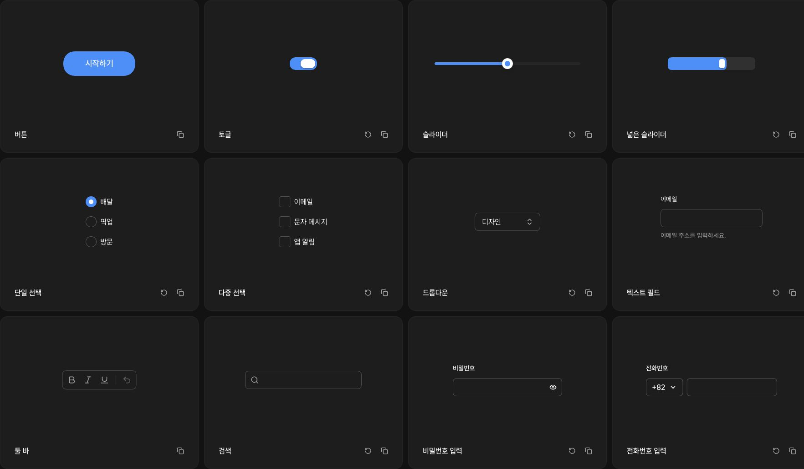

# COMPASS Design System

**Good UX, by default. Built for people. Ready for AI.**

A UX-focused design system for React. Start with considered components, consistent design tokens, and practical rules that people and AI agents can use together.

[Explore components](https://compass.designcompass.org/) · [Get started](https://compass.designcompass.org/docs/ai) · [Plus membership](https://compass.designcompass.org/pricing)



## Run the included example

This repository includes a small preferences form using synthetic data. It has no backend, telemetry, membership data, or email delivery.

```sh
npm install
npm run dev
```

Open the local URL printed by Next.js. Check the form in light and dark themes, then run `npm test`, `npm run typecheck`, and `npm run build`.

## Why COMPASS?

There are plenty of UI libraries built around striking colors and motion. COMPASS focuses on the experience of using a product again and again: clear actions, understandable states, consistent controls, and details that stay out of the way.

Use it to build settings screens, forms, dashboards, and everyday tools, not just the page that introduces them.

## What you get

- **Components you can inspect and change.** Install source files into your project instead of hiding them behind a package abstraction.
- **A shared visual foundation.** Light and dark themes, design tokens, typography, spacing, and control states.
- **Practical design rules.** Component-specific Do / Don't guidance for choosing and using the right control.
- **AI-ready workflows.** A Basic Skill and public MCP endpoint help your agent find public guidance. Plus adds deeper design material and Pro access.
- **Versioned installation.** Pin a Registry release and decide when to update your project's customized files.

The 1.0.0 release contains **37 shared UI components** across **42 Registry items**, including foundations and the complete kit. The website offers **120+ gallery examples and variants**; those are not 120 separate component packages.

## Start building

### With an AI coding agent

Open [Install with AI](https://compass.designcompass.org/docs/ai), copy the setup prompt, and give it to an agent that can inspect and edit your project.

The prompt guides the agent through installation, theme integration, persistent project instructions, and verification. After setup, ask it to **use COMPASS** when building a feature.

### Install directly

Use an existing **React + Tailwind CSS v4** project with shadcn configured. From your project directory, install the pinned foundations and complete kit:

```sh
npx shadcn@latest add \
  https://compass.designcompass.org/r/1.0.0/foundations.json \
  https://compass.designcompass.org/r/1.0.0/compass.json
```

To install just a button and its foundations:

```sh
npx shadcn@latest add \
  https://compass.designcompass.org/r/1.0.0/foundations.json \
  https://compass.designcompass.org/r/1.0.0/button.json
```

Review changes before replacing customized components. Connect the installed theme provider to your application root, follow `docs/compass.md`, and check the result in both themes. Installing files alone does not finish application integration.

Browse the [versioned Registry catalog](https://compass.designcompass.org/r/1.0.0/registry.json) for individual items.

### Use the public GitHub registry

The free distribution also provides a flat [public Registry index](https://raw.githubusercontent.com/design-compass/compass-design-system/main/r/registry.json) and individual install payloads under `r/`.

Add this mapping to the `registries` object in your existing `components.json` to use the namespace directly, independently of directory approval:

```json
{
  "registries": {
    "@compass": "https://raw.githubusercontent.com/design-compass/compass-design-system/main/r/{name}.json"
  }
}
```

Then install the foundations explicitly together with your component:

```sh
npx shadcn@latest add @compass/foundations @compass/button
```

Merge the mapping with your existing configuration; do not replace the entire file. The `main` URLs follow this repository's current public distribution. Pin a Git commit in those URLs when you need an immutable revision. Rebuild the public payloads with `npm run registry:build` after reviewing source changes.

## Connect your agent

**Skill** gives your agent a reusable workflow and public component rules. **MCP** lets it look up current public guidance as it works. Neither replaces installing and testing the components in your project.

- [Download the Basic Skill](https://compass.designcompass.org/api/ai/skill/basic)
- Basic MCP endpoint: `https://compass.designcompass.org/api/mcp/basic`
- [Client-specific setup and Plus connections](https://compass.designcompass.org/account?view=ai)
- [Public AI reference](https://compass.designcompass.org/llms-full.txt)

The Basic MCP endpoint does not require a Plus key. Pro connections require an active Plus entitlement and a personal connection key. Never commit a personal key to a repository.

## Free and Plus

| | Free | Plus |
| --- | --- | --- |
| Public components, source, and design foundations | Included | Included |
| Basic Design Skill and MCP | Included | Included |
| In-depth design research and detailed guides | Not included | Included |
| Pro Design Skill and MCP access | Not included | Included |
| Early access to new updates | Not included | Included |

On the website, visitors can preview a selection of components. A free account unlocks the full gallery. Publicly distributed code remains available under its stated license.

Explore [Plus membership](https://compass.designcompass.org/pricing) for current pricing and membership details.

## License

Original code and Basic materials in this repository are MIT-licensed. Preserve the notices in [THIRD_PARTY_NOTICES.md](THIRD_PARTY_NOTICES.md) and source headers. The screenshot is a product illustration, not a grant of rights to the COMPASS brand.

Follow the license attached to each item. Code explicitly released under MIT may be used in commercial projects under the MIT terms; retain the required copyright and license notices. Third-party assets retain their own licenses.

Plus documents, protected images, paid Skills, and private service code are not made open source by the public component distribution. See the [license policy](https://compass.designcompass.org/license) for details.

## Feedback

Found a confusing state or a detail that makes repeated use harder? Send the component name, expected behavior, and a small reproduction to [help@designcompass.org](mailto:help@designcompass.org).

Built something with COMPASS? We'd love to see how it works in a real product.
